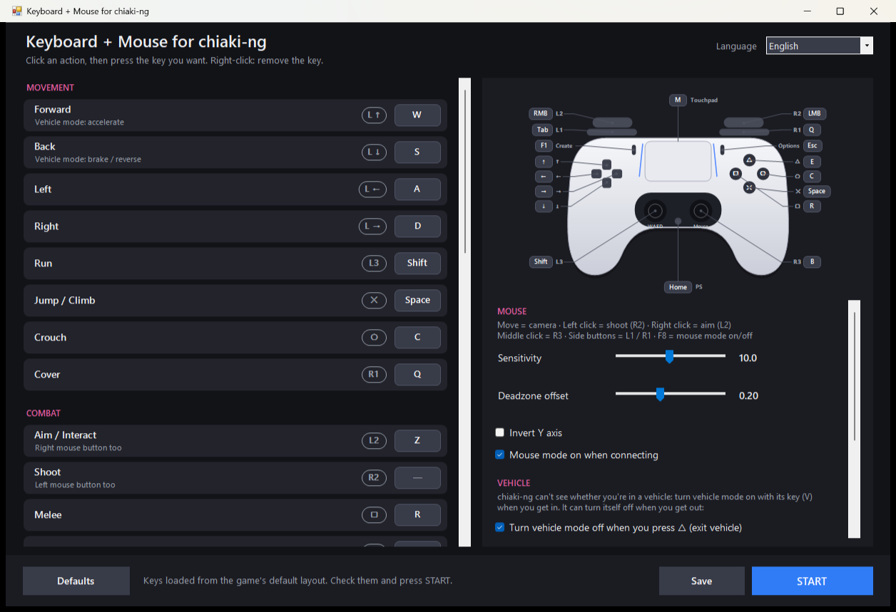
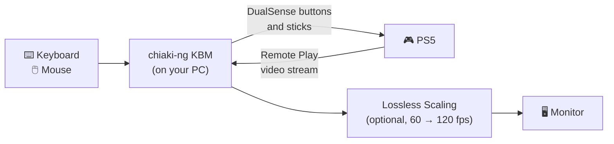
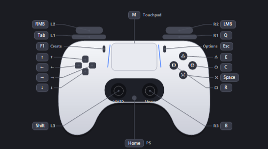
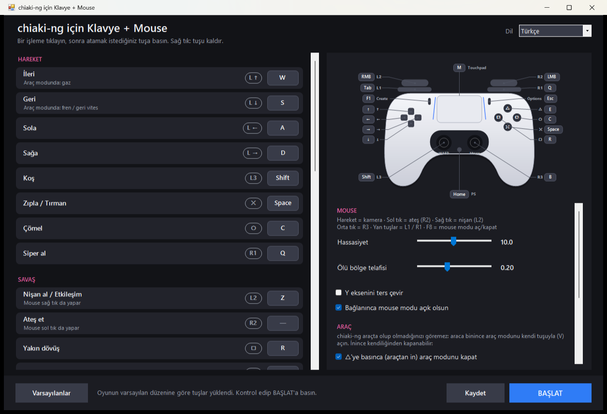

<h1 align="center">chiaki-ng KBM</h1>

<p align="center">
  <b>Play PS5 games over Remote Play with a keyboard and mouse on Windows.</b><br>
  An unofficial fork of <a href="https://github.com/chiaki-ng/chiaki-ng">chiaki-ng</a> with mouse look and a key-binding launcher.
</p>

<p align="center">
  <a href="https://github.com/AhmetQara/chiaki-ng-kbm/releases/latest"></a>
  
  <a href="COPYING"></a>
</p>

<p align="center">
  
</p>

Not affiliated with Sony Interactive Entertainment, Rockstar Games or the chiaki-ng project.

## How it works



The PS5 sees an ordinary DualSense. chiaki-ng KBM turns your key presses into its buttons and your mouse movement into its right stick, so it works with any game and needs nothing installed on the console.

## Quick start

1. **Download** `chiaki-ng-kbm-…-win_x64.zip` from [Releases](https://github.com/AhmetQara/chiaki-ng-kbm/releases/latest) and extract it anywhere.
   - Every release is built by GitHub Actions from this repository's source ([workflow](.github/workflows/build-windows-kbm.yml)). Nothing in it was built on someone's PC.
2. **Run `KBM Launcher.exe`.** Check the keys, change any you like, and press **START**.
3. **First time only:** in chiaki-ng, register your PS5 the usual way (Settings → PSN login, then the PIN shown on the PS5 under *Settings → System → Remote Play → Link Device*).
   - If you already use chiaki-ng, your registration carries over: both use the same settings.
4. **Connect and play.** Press **F8** any time to turn mouse mode on or off.

## Setting your keys



- **Click any action** in the list (for example *Run*), then press the key you want. Shift, Ctrl, Alt, Tab and Esc all work.
- **Right-click** an action to remove its key.
- **Same key twice?** If you pick a key that another action already uses, the two swap, so nothing is ever bound twice.
- **The diagram follows you:** hover an action and its button lights up on the controller.
- **Languages:** English, Türkçe, Español, Português, Français, Deutsch, Русский, 中文 (top right).

<br clear="right">

## Default keys

The defaults follow the default control scheme of GTA VI, with the usual PC keys.

| On foot | Key | PS5 |
|---|---|---|
| Move | **W A S D** | Left stick |
| Look / aim | **Mouse** | Right stick |
| Aim / interact | **Right click** | L2 |
| Shoot | **Left click** | R2 |
| Run | **Shift** | L3 |
| Jump / climb | **Space** | ✕ |
| Crouch | **C** | ○ |
| Interact / enter vehicle | **E** | △ |
| Melee | **R** | ▢ |
| Cover | **Q** | R1 |
| Holster | **Tab** | L1 |
| Look behind | **Middle click** / **B** | R3 |
| Focus mode | **Caps Lock** | L3 + R3 |
| Map | **M** | Touchpad |
| Pause | **Esc** | Options |
| Phone / D-pad | **Arrow keys** | D-pad |
| Confirm / back in menus | **Enter** / **X** | ✕ / ○ |

| In a vehicle (press **V** when you get in) | Key | PS5 |
|---|---|---|
| Accelerate / brake-reverse | **W** / **S** | R2 / L2 |
| Steer | **A** / **D** | Left stick |
| Shoot | **Left click** | R1 |
| Handbrake | **Space** | ✕ |
| Horn / nitrous | **Shift** | L3 |
| Headlights | **C** | ○ |
| Exit vehicle (also turns vehicle mode off) | **E** | △ |

chiaki-ng can't see whether you're in a vehicle, so vehicle mode is turned on by hand (**V**). It turns itself off when you press **E** to get out.

## Tips

- **In-game camera sensitivity:** set it high, and turn off any camera acceleration. The console only sees stick movement, so the game's own sensitivity is the top speed; the launcher's *Sensitivity* sets how far the mouse pushes the stick.
- **In-game deadzone:** set it low, then lower the launcher's *Deadzone offset* to match (for example 0.05–0.10).
- **Smoother picture:** stream at 60 fps and use frame generation such as [Lossless Scaling](https://store.steampowered.com/app/993090/Lossless_Scaling/) (LSFG, ×2) on the chiaki-ng window for 120 fps.
- **Wired network:** connect the PS5 and the PC with cables if you can. It makes the biggest difference to latency.

<details>
<summary>Launcher in Turkish (screenshot)</summary>
<br>

</details>

## Building

From an MSYS2 MINGW64 shell with the packages listed in the [workflow](.github/workflows/build-windows-kbm.yml):

```bash
scripts/build-windows-kbm.sh
```

The output goes to `dist/chiaki-ng-kbm`.

## Support the project

If chiaki-ng KBM makes your games better, you can support its development:

<p>
  <a href="https://github.com/sponsors/AhmetQara"></a>
  &nbsp;&nbsp;
  <a href="https://buymeacoffee.com/ahmetqara"></a>
</p>

This fork is built on [chiaki-ng](https://github.com/chiaki-ng/chiaki-ng) by streetpea and its contributors.

## License

chiaki-ng is licensed under the GNU AGPL v3 with an OpenSSL exception (see [COPYING](COPYING)), and so is this fork. The source for every release is this repository. The original chiaki-ng README is in [README-chiaki-ng.md](README-chiaki-ng.md).
